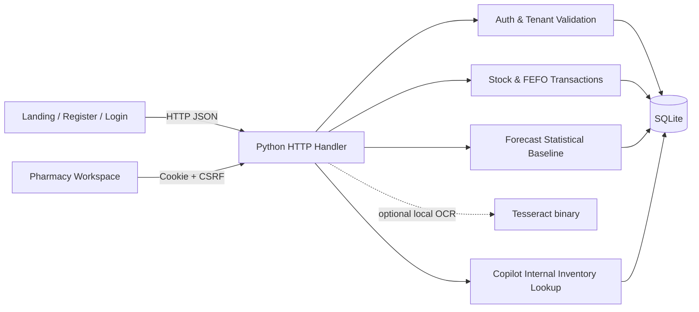

# Architecture — PharmaVision AI MVP v0.2.0

## Thành phần

All write operations require active server-side session and CSRF token. A separate user account is stored with a `pharmacy_id` and role. The server reads the tenant id from the session, never from the request body.

## Main tables

- `pharmacies`: tenant/workspace.
- `users`, `sessions`: authentication.
- `products`, `batches`: SKU and per-batch stock, supplier, status, expiry.
- `stock_moves`: inventory changes (import, sale, adjustment).
- `sales`, `sale_lines`: completed sales and batch allocations.
- `customers`: customer consent and optional notes, not safe for real clinical data in the demo.
- `recalls`: manually entered recall/quality notices.
- `audit`: significant server-side actions; not tamper-proof.

## Stock workflow

1. Add product information and pharmacist-verified catalog fields.
2. Import a batch with `lot`, `expires`, `qty`, supplier and cost. A matching `lot` for the same product must have an identical expiry.
3. The system calculates total and sellable stock separately. A batch is sellable only if status is `active`, quantity > 0 and expiry has not passed.
4. The sales endpoint locks the database transaction, revalidates all stock quantities, and assigns batches in **FEFO** (first expiring, first out) order.
5. If any product is not fully available, the whole sale is rolled back; otherwise sale lines, quantity reductions, movement logs and audit are committed together.
6. Recall entries are **manual**. Matching batches are switched to `quarantine` and cannot be sold; releasing a batch with a matching recall is blocked.

## Identity and access

| Operation | Staff | Admin |
| --- | :---: | :---: |
| Read tenant's products and report | ✓ | ✓ |
| Create product and import batch | ✓ | ✓ |
| Complete sale with pharmacist confirmation | ✓ | ✓ |
| Add customer with consent | ✓ | ✓ |
| Stock adjustment / quarantine / recall | — | ✓ |
| Add users, delete customers and view audit log | — | ✓ |

A role is only a **technical permission**, not verification of a real pharmacist license.

## API routes

- Public: `POST /api/register`, `POST /api/login`, `GET /api/me`.
- Session: `POST /api/logout`, `POST /api/password`.
- Workspace: `GET /api/dashboard`, `GET/POST /api/products`, `POST /api/stock/import`, `POST /api/stock/adjust`, `POST /api/stock/hold`.
- Sales: `GET/POST /api/sales`.
- Customers: `GET/POST /api/customers`, `GET /api/customers/{id}/history`, `DELETE /api/customers/{id}`.
- Alerts: `GET/POST /api/recalls`.
- Analytics: `GET /api/forecast?days=14&lead=7`.
- Internal helper: `POST /api/copilot` (catalog lookup only), `POST /api/ocr` (Tesseract optional), `GET /api/ai/status`.
- Admin: `GET/POST /api/users`, `GET /api/audit`.

No external AI provider, government API, official prescription verification or Zalo OAuth is currently used.

## Security and privacy limitations

This single-process demo lacks a production reverse proxy, WAF, standardized observability, application-level data encryption, backup restore procedures, auditable consent lifecycle and independent penetration testing. It is unsuitable for production healthcare usage. `http.server` should remain loopback-only. The field `prescription_code` is a user-supplied reference, not a verified government e-prescription. There is no approved clinical drug-interaction dataset.
